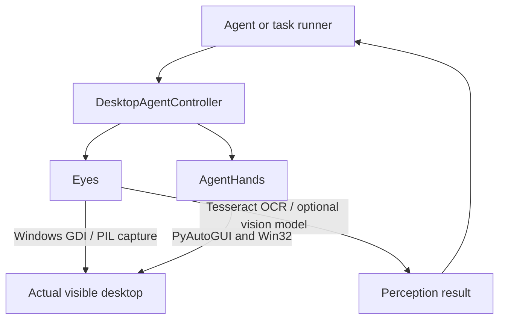

# Architecture

## Purpose

The system lets an agent work directly on the current Windows desktop using the same visible mouse and keyboard interaction primitives a person uses. There is no duplicate desktop, canvas, or browser-only workspace.

## Runtime model

## Components

| Component | Role |
| --- | --- |
| `ai_controller.py` | `DesktopAgentController`: direct high-level façade for perception, window inspection, mouse, keyboard, and task screenshot cleanup. |
| `agent_server.py` | Loopback-only authenticated FastAPI service exposing direct `/eyes/*` and `/hands/*` operations with Bearer auth, DNS rebinding protection, and input concurrency locks. |
| `api_client.py` | Python client for `agent_server.py` with automatic bearer token discovery and task session context manager. |
| `Eyes/eyes.py` | Screen capture, OCR, text lookup, screen map, visual descriptions, screenshot lifecycle, and lower-level input helpers. |
| `Eyes/eyes_server.py` | Optional FastAPI wrapper for Eyes on port 8421. |
| `Eyes/eyes_mcp.py` | Optional MCP server for Eyes over stdio. |
| `Hands/agent_hands` | PyAutoGUI/Win32 mouse, keyboard, typing simulation, window management, and MCP utilities. |
| `Hands/agent_hands/server.py` | Optional AgentHands MCP server over stdio. |
| `tools.json` | Registry for Windows utility scripts. |

## Task lifecycle

1. An agent creates `DesktopAgentController` (or `DesktopAgentClient`).
2. It opens `controller.task("task_name")` when screenshots should be temporary.
3. Eyes captures or OCRs the real desktop and returns text, boxes, confidence, and/or visual descriptions.
4. The agent identifies a target and calls direct mouse or keyboard methods.
5. On context exit, Eyes automatically deletes screenshots registered during that task.

## Coordinate system

All Eyes and AgentHands coordinates are physical Windows screen coordinates:

- Origin: top-left of the primary display.
- `x` increases rightward; `y` increases downward.
- OCR element coordinates are absolute screen coordinates.
- Mouse actions use those same coordinates directly.

Windows high-DPI awareness is enabled in Eyes to reduce coordinate scaling mismatches.

## Security and Concurrency Model

- **Authentication**: `agent_server.py` requires Bearer token authentication for all perception and input endpoints. Tokens are loaded from `AGENT_AUTH_TOKEN` or generated at startup and written to `.agent_token`.
- **DNS Rebinding Defense**: Incoming requests are validated against allowed `Host` headers (`localhost`, `127.0.0.1`, `testserver`) to prevent browser-based DNS rebinding attacks.
- **Physical Input Lock**: All `/hands/*` operations run under a synchronized thread lock to prevent interleaving of concurrent mouse and keyboard operations.
- **Emergency Fail-Safe**: PyAutoGUI's corner fail-safe is enabled (`FAILSAFE = True`). Slamming the cursor to any screen corner immediately halts automation.
- **Clipboard Restoration**: Text pasted via `/hands/paste` automatically backs up and restores previous clipboard contents.
- **Strict Validation**: All endpoints use Pydantic models with `Literal` types and model validators to ensure valid parameters (e.g. coordinates provided in pairs).
