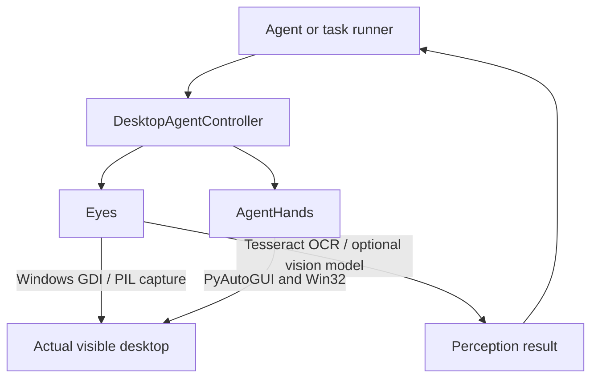

# Architecture

## Purpose

The system lets an agent work directly on the current Windows desktop using the same visible mouse and keyboard interaction primitives a person uses. There is no duplicate desktop, canvas, or browser-only workspace.

## Runtime model

## Components

| Component | Role |
| --- | --- |
| `ai_controller.py` | `DesktopAgentController`: direct high-level façade for perception, window inspection, mouse, keyboard, and task screenshot cleanup. |
| `agent_server.py` | Optional loopback-only FastAPI service exposing direct `/eyes/*` and `/hands/*` operations. |
| `api_client.py` | Thin Python client for `agent_server.py`. |
| `Eyes/eyes.py` | Screen capture, OCR, text lookup, screen map, visual descriptions, screenshot lifecycle, and lower-level input helpers. |
| `Eyes/eyes_server.py` | Optional FastAPI wrapper for Eyes on port 8421. |
| `Eyes/eyes_mcp.py` | Optional MCP server for Eyes over stdio. |
| `Hands/agent_hands` | PyAutoGUI/Win32 mouse, keyboard, typing simulation, window management, and MCP utilities. |
| `Hands/agent_hands/server.py` | Optional AgentHands MCP server over stdio. |
| `tools.json` | Separate registry for Windows utility scripts; its referenced `scripts/` directory is not present in this workspace. |

## Task lifecycle

1. An agent creates `DesktopAgentController`.
2. It opens `controller.task("task_name")` when screenshots should be temporary.
3. Eyes captures or OCRs the real desktop and returns text, boxes, confidence, and/or visual descriptions.
4. The agent identifies a target and calls direct mouse or keyboard methods.
5. On context exit, Eyes deletes screenshots registered during that task.

## Coordinate system

All Eyes and AgentHands coordinates are physical Windows screen coordinates:

- Origin: top-left of the primary display.
- `x` increases rightward; `y` increases downward.
- OCR element coordinates are absolute screen coordinates.
- Mouse actions use those same coordinates directly.

Windows high-DPI awareness is enabled in Eyes to reduce coordinate scaling mismatches.

## Boundaries and risks

- This is real desktop automation. A click, keypress, scroll, or paste affects the active Windows application immediately.
- The code has no task planner or language model built in. An external agent, MCP client, or Python program chooses the sequence of perception and actions.
- `find_on_screen()` is OCR-based; it can return ambiguous or incorrect matches. Callers should verify the target before consequential actions.
- Screenshots captured outside an Eyes task session remain under `Eyes/screenshots/`.
- The Chrome profile/cache directories left in this workspace are legacy runtime data from the removed canvas implementation. They are no longer used by the direct desktop controller.
