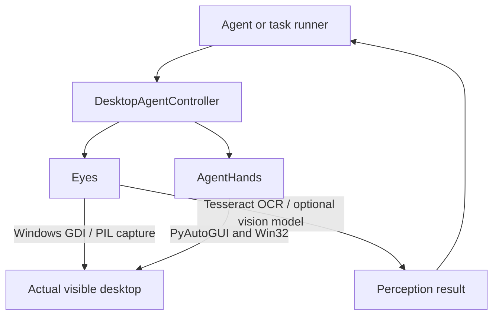

# Architecture

## Purpose

The system lets an agent work directly on the current Windows desktop using the same visible mouse and keyboard interaction primitives a person uses. There is no duplicate desktop, canvas, or browser-only workspace.

## Runtime model



## Components

| Component | Role |
| --- | --- |
| `ai_controller.py` | `DesktopAgentController`: direct high-level façade for perception (`observe`, `zoom`, `wait_for_text`), window inspection, mouse, keyboard, and task screenshot cleanup. |
| `agent_server.py` | Loopback-only authenticated FastAPI service exposing direct `/eyes/*` and `/hands/*` operations with Bearer auth, DNS rebinding protection, and input concurrency locks. |
| `api_client.py` | Python client for `agent_server.py` with automatic bearer token discovery and task session context manager. |
| `Eyes/eyes.py` | Primary perception façade delegating to modular perception subsystems; manages screenshot lifecycles and caches. |
| `Eyes/coords.py` | Per-monitor DPI awareness initialization, bounding box math, coordinate clamping, and IoU computation. |
| `Eyes/schema.py` | Standardized `UIElement` and `Observation` dataclasses with element caching and ID-to-point coordinate resolution. |
| `Eyes/uia.py` | Windows UI Automation provider via `pywinauto` / `uiautomation` with foreground traversal budget and attribute safety. |
| `Eyes/ocr.py` | Tuned OCR engine with dark-theme background inversion, cubic upscale, sparse PSM mode, and phrase grouping. |
| `Eyes/cv_detect.py` | Computer vision fallback for custom-drawn buttons via Canny edge / contour detection and template matching. |
| `Eyes/annotate.py` | Set-of-Marks visual overlay rendering (numbered badges sorted large-box first), labeled A1-L8 grid, and spatial text layouts. |
| `Eyes/diffing.py` | Grayscale downscaled frame diffing for screen change detection and adaptive polling synchronization. |
| `Eyes/observe.py` | Multi-source observation pipeline uniting UIA, OCR, and CV with IoU deduplication and natural reading-order sorting. |
| `Hands/agent_hands` | PyAutoGUI/Win32 mouse, keyboard, typing simulation, window management, and MCP utilities. |
| `tools.json` | Registry for Windows utility scripts. |

## Element-Based Grounding Pipeline

Instead of forcing LLMs to guess pixel coordinates from raw screenshots, the agent uses a structured grounding pattern:

```text
Desktop Screen
      │
      ├────────────────────────┬────────────────────────┐
      ▼                        ▼                        ▼
Windows UIA Tree           Tuned OCR               CV Contours
(Roles, Names, States)  (Dark Inverted, Lines)   (Custom Buttons)
      │                        │                        │
      └────────────────────────┼────────────────────────┘
                               ▼
                   observe.py (Merge & Dedupe)
                  • IoU Deduplication (IoU > 0.4)
                  • Reading Order Sort (Y-band, X)
                  • Sequential ID Assignment
                               │
            ┌──────────────────┴──────────────────┐
            ▼                                     ▼
Observation Metadata                     Set-of-Marks Image
{ id: 12, role: "Button", name: "Save" }   [12] [Save]
            │                                     │
            └──────────────────┬──────────────────┘
                               ▼
                        Consuming LLM
                     Selects Element ID
                               ▼
                 Hands: click_element(id)
```

## Task lifecycle

1. An agent creates `DesktopAgentController` (or `DesktopAgentClient`).
2. It opens `controller.task("task_name")` when screenshots should be temporary.
3. Eyes captures or OCRs the real desktop and returns text, boxes, confidence, and/or visual descriptions.
4. The agent identifies a target and calls direct mouse or keyboard methods.
5. On context exit, Eyes automatically deletes screenshots registered during that task.

## Coordinate system

All Eyes and AgentHands coordinates are physical Windows screen coordinates:

- Origin: top-left of the primary display.
- `x` increases rightward; `y` increases downward.
- OCR element coordinates are absolute screen coordinates.
- Mouse actions use those same coordinates directly.

Windows high-DPI awareness is enabled in Eyes to reduce coordinate scaling mismatches.

## Security and Concurrency Model

- **Authentication**: `agent_server.py` requires Bearer token authentication for all perception and input endpoints. Tokens are loaded from `AGENT_AUTH_TOKEN` or generated at startup and written to `.agent_token`.
- **DNS Rebinding Defense**: Incoming requests are validated against allowed `Host` headers (`localhost`, `127.0.0.1`, `testserver`) to prevent browser-based DNS rebinding attacks.
- **Physical Input Lock**: All `/hands/*` operations run under a synchronized thread lock to prevent interleaving of concurrent mouse and keyboard operations.
- **Emergency Fail-Safe**: PyAutoGUI's corner fail-safe is enabled (`FAILSAFE = True`). Slamming the cursor to any screen corner immediately halts automation.
- **Clipboard Restoration**: Text pasted via `/hands/paste` automatically backs up and restores previous clipboard contents.
- **Strict Validation**: All endpoints use Pydantic models with `Literal` types and model validators to ensure valid parameters (e.g. coordinates provided in pairs).
