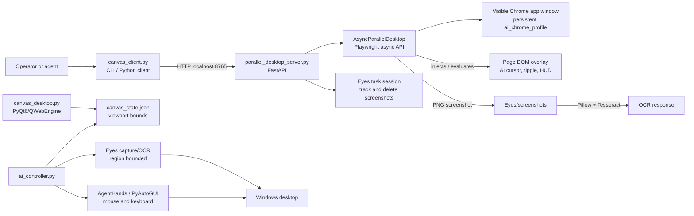
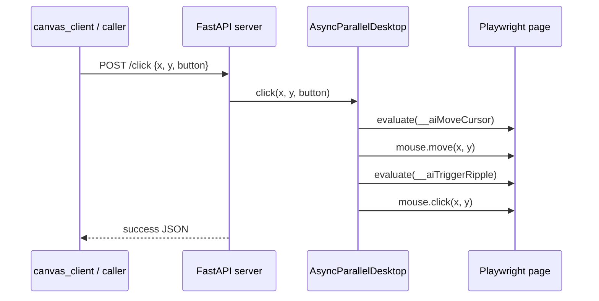

# Current Architecture

## Scope

This document describes the implementation present in the repository as of October 2026. It intentionally separates the active **parallel-browser** runtime from the alternative **native desktop** runtime. They share helper code but do not form one integrated service.

## System overview

### Architectural interpretation

The top path is the primary local API service. It creates a browser owned by Playwright, so actions are browser-protocol commands rather than OS-level pointer events. The bottom path is a second, native-window design. It relies on screen coordinates and PyAutoGUI, and therefore is materially different: it applies coordinate clamping but still uses the Windows desktop for capture, focus, pointer, and keyboard operations.

The initial Desktop Agent Control Center is rendered by `desktop_home.html`. It stores a visible task and sends action requests to a server-side, in-memory approval queue. Its three modes are `observe`, `ask`, and `routine`. This queue gates actions initiated through that control panel only; existing low-level API routes remain available for programmatic clients.

## Components

| Component | Responsibility | Interfaces / state |
| --- | --- | --- |
| `parallel_desktop_server.py` | Starts the FastAPI app, owns the async browser, and maps HTTP calls to browser actions. | HTTP on `127.0.0.1:8765`; global `canvas`. |
| `AsyncParallelDesktop` | Launches persistent Chrome, navigates, sends Playwright input, captures screenshots, and calls Tesseract. | Playwright async API, `ai_chrome_profile/`, `Eyes/screenshots/`. |
| `parallel_canvas.py` | Provides the sync counterpart (`ParallelCanvasDesktop`) and the JavaScript overlay shared with the server. | Playwright sync API; optionally attaches to Chrome DevTools on port 9222. |
| `canvas_client.py` | Thin `requests` client and CLI. | Calls canvas HTTP endpoints. |
| `desktop_home.html` | Static landing page displayed before navigation. | Loaded with a `file:///` URL. |
| `Eyes/eyes.py` | Vision foundation: high-DPI capture, OCR, text lookup, visual description, input actions, task screenshot lifecycle. | Screenshot directory, Tesseract, optional Ollama and other provider credentials. |
| `Eyes/eyes_server.py` / `eyes_mcp.py` | Standalone REST and MCP wrappers for Eyes. | REST `127.0.0.1:8421`; MCP stdio. |
| `Hands/agent_hands` | Human-like typing, keyboard/mouse actions, window focus, MCP wrappers. | `pyautogui`, Win32 APIs, MCP stdio. |
| `canvas_desktop.py` | Native PyQt6 browser canvas. Writes exact web-view desktop bounds. | `canvas_state.json`. |
| `ai_controller.py` | Reads native canvas bounds and binds Eyes and AgentHands operations to them. | Python API/context manager. |
| `tools.json` | Declarative registry for OS-oriented scripts. | References absent `scripts/`; unused by current runtimes. |

## Primary parallel-browser flow

### Startup

1. `python parallel_desktop_server.py` runs Uvicorn with FastAPI lifespan management.
2. The lifespan handler instantiates `AsyncParallelDesktop(1240, 800)`.
3. `start()` ensures `ai_chrome_profile/` exists, starts Playwright, and launches a non-headless persistent Chrome context using the Chrome channel.
4. Chrome opens as an app window at a local `file:///.../desktop_home.html` page unless a different URL is supplied in code.
5. `CURSOR_INJECTION_JS` is registered as an init script and evaluated on the active page. It adds a DOM-level cyan pointer, click ripple animation, and HUD.
6. The server marks the page as ready and listens at `127.0.0.1:8765`.

### Control request

Inputs (`move`, `click`, `type`, `press`, and `scroll`) are sent to Playwright's active page. The visual overlay does not carry out the action; it merely displays it. Navigation calls `page.goto(..., wait_until="domcontentloaded")` and then attempts overlay reinjection.

### Screenshot and OCR flow

1. `GET /capture` calls `page.screenshot()` and writes `Eyes/screenshots/canvas_screen_<timestamp>.png`.
2. If an `Eyes.TaskSession` is active, the screenshot path is registered with it.
3. `GET /ocr` first takes a screenshot, opens it with Pillow, then calls Tesseract.
4. With `detailed=true`, OCR returns word-level confidence, bounding box, and viewport-relative center coordinates.
5. `POST /task/end` invokes `eyes.end_task()`, which deletes only files registered in the active task session.

The timestamp used by the parallel canvas has second precision, so multiple captures in the same second can select the same filename. This is an implementation risk for rapid capture calls.

## Native desktop route

The PyQt route is launched independently with `python canvas_desktop.py [url]`.

1. `AIDesktopCanvas` builds a HUD, address bar, and embedded `QWebEngineView`.
2. On window show/move/resize and every second, `update_state_file()` writes the web-view's global desktop rectangle to `canvas_state.json`.
3. `CanvasAIController.sync_canvas_bounds()` reads this file, configures `eyes.set_canvas_region(...)`, and configures `agent_hands.mouse.set_canvas_bounds(...)`.
4. Eyes captures/OCRs that region; AgentHands clamps pointer locations to it.

The controller's `focus`, `click`, `scroll`, natural typing, paste, and key functions use real desktop APIs. Unlike the Playwright route, these can bring the window forward, move the physical cursor, and type into the active operating-system window. The coordinate clamp is a guardrail, not a process or operating-system sandbox.

## Eyes subsystem

`Eyes/eyes.py` is stateful at module level:

- `_ACTIVE_CANVAS_REGION`: optional `(x, y, width, height)` used by capture/OCR/find calls when no explicit region is supplied.
- `_ACTIVE_TASK_SESSION`: one active task globally per process.
- `TaskSession`: records screenshot filenames and removes them in `cleanup()`.

Capture prefers Windows GDI for region capture and falls back to `PIL.ImageGrab`. OCR is performed by Tesseract. `find_on_screen()` identifies OCR text with a basic case-insensitive/sub-string strategy; it does not use semantic element detection or DOM selectors. `describe()` tries Ollama first and can fall back through configured providers or an OCR-only summary.

The Eyes REST service on port 8421 and its MCP server are independent of the parallel-browser server. Without the native controller first setting a region, their screen and input tools act on the desktop rather than on the browser viewport.

## AgentHands subsystem

AgentHands implements:

- `TypingEngine`: randomized key timing, punctuation and cognitive pauses, and optional QWERTY-neighbor typo/correction simulation.
- `mouse.py`: move, click, scroll, and drag using PyAutoGUI; it supports optional canvas coordinate clamping.
- `windows.py`: window listing and focusing through Windows APIs.
- `server.py`: MCP tools for type, hotkeys, paste, pointer control, scroll, and status.

Its test suite covers utility and wrapper behavior with mocks. It does not prove end-to-end desktop isolation.

## API surface of the primary service

| Endpoint | Behavior | Notes |
| --- | --- | --- |
| `GET /health` | Returns static liveness JSON. | Does not validate Chrome. |
| `GET /status` | Reports URL, cursor, viewport, active task. | `503` if page is unavailable. |
| `POST /navigate` | Navigates current page. | No URL allowlist or scheme validation. |
| `POST /move`, `/click` | Sends viewport coordinates to Playwright. | No server-side bounds validation. |
| `POST /type`, `/press`, `/scroll` | Sends page keyboard/wheel events. | Operates on current page/focus. |
| `POST /status_hud` | Updates injected text in the page. | Best effort; injection can fail. |
| `POST /task/start`, `/task/end` | Starts/ends shared Eyes session. | One global session; a new one cleans up the old one. |
| `GET /capture`, `/ocr` | Captures/OCRs page viewport. | Images outside a task remain on disk. |
| `POST /order_chocolate` | Coordinate-driven Swiggy search demo. | No checkout or authorization flow. |

## Persistence and boundaries

| Resource | Current behavior |
| --- | --- |
| HTTP server | Loopback-only (`127.0.0.1`) and no authentication. |
| Browser profile | Persistent under `ai_chrome_profile/`; keeps browser state across starts. |
| Screenshots | Created under `Eyes/screenshots/`; auto-deleted only if registered in an active task. |
| `canvas_state.json` | Runtime state; overwritten by the PyQt window. |
| `canvas_user_dir/` | Generated Chromium profile/cache currently not read by the primary server. |
| Browser action isolation | Browser-protocol isolation in the Playwright route; no equivalent OS isolation in native route. |

## Current gaps and risks

1. **Dependency drift.** `requirements.txt` does not declare FastAPI, Uvicorn, Playwright, Pydantic, Tesseract wrapper dependencies, MCP, or PyQt dependencies used by the code.
2. **Two overlapping implementations.** The async server duplicates much of `ParallelCanvasDesktop`, but only the async version is used by the primary HTTP service. There is no lifecycle coordinator selecting or reconciling them.
3. **Profile sensitivity.** A persistent Chrome profile can retain authentication cookies and browsing data. The code has no profile isolation, cleanup, or secrets policy.
4. **Insufficient input validation.** Browser coordinates and URLs are accepted as supplied; `status` strings are interpolated into JavaScript after limited quote escaping.
5. **Brittle demo automation.** The chocolate flow uses hard-coded coordinates and time delays, so layout, consent dialogs, login, geolocation, and site changes can break it. It performs no purchase completion.
6. **Task lifecycle is optional.** Screenshot retention protection depends on callers explicitly creating and ending a task. An error in a scripted flow can leave screenshots behind because some endpoints lack `finally` cleanup.
7. **Canvas bounds depend on a file.** The native path reads mutable `canvas_state.json` without staleness checks or synchronization. If the window is closed or moved before an update, its clamp may be inaccurate.
8. **No integrated end-to-end tests.** Existing tests are confined to AgentHands; server startup, Chrome control, OCR, screenshot cleanup, and native canvas bounding are unverified.
9. **Unused registry.** `tools.json` references missing scripts. It is documentation/configuration only in this workspace.

## Recommended evolution

1. Choose the primary runtime (the FastAPI/Playwright route is the most self-contained) and make the native route explicitly optional or remove duplicated control logic.
2. Create a root `pyproject.toml` or complete lockfile, including optional dependency groups for server, OCR, native canvas, and development tools.
3. Give each task a unique task ID and per-task screenshot directory; clean up with `try/finally` in all task routes.
4. Add input models that bound coordinates to the viewport, restrict navigation schemes, and avoid JavaScript string interpolation.
5. Add smoke tests for server lifecycle and mocked Playwright APIs, plus integration tests for screenshot cleanup and detailed OCR response shape.
6. Treat profile data as sensitive: document its contents, allow a configurable path, and offer an ephemeral/incognito-style execution option.
